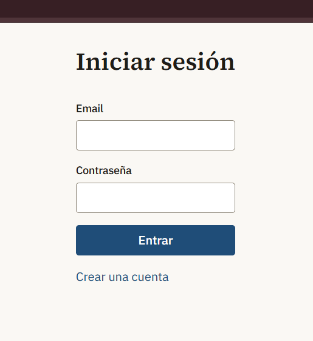
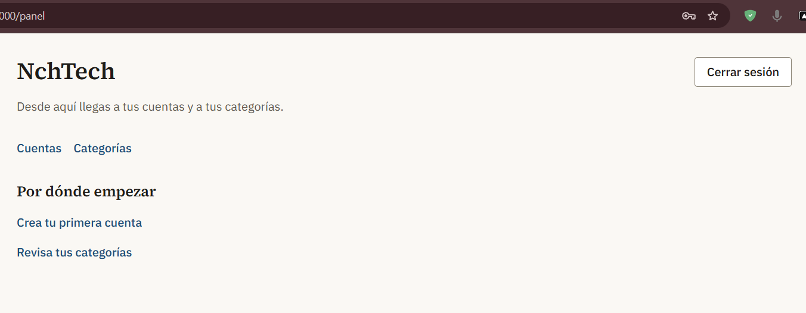
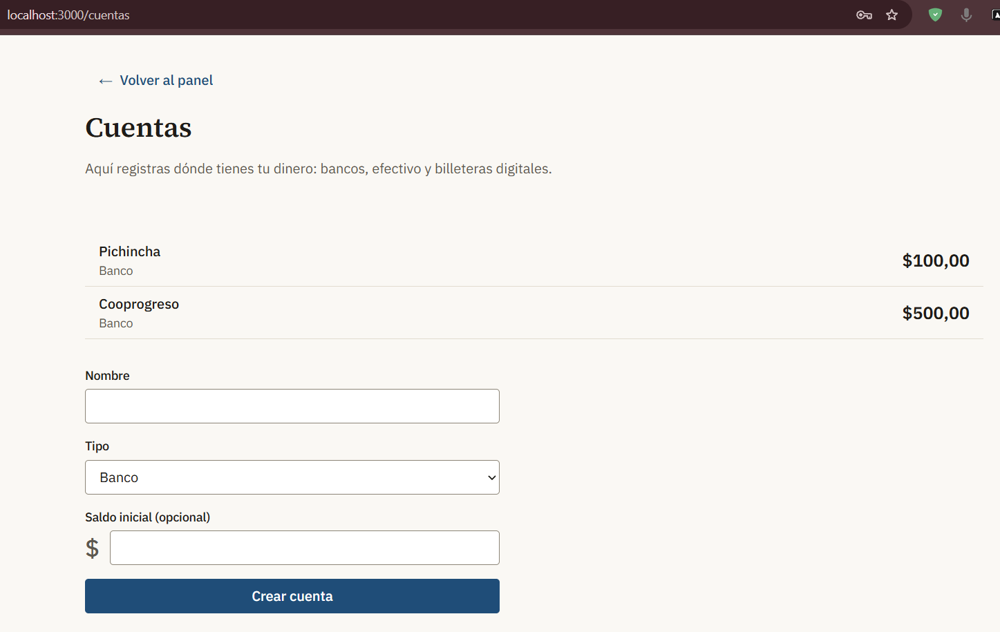
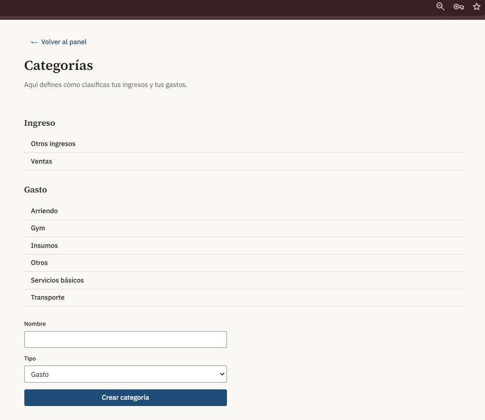
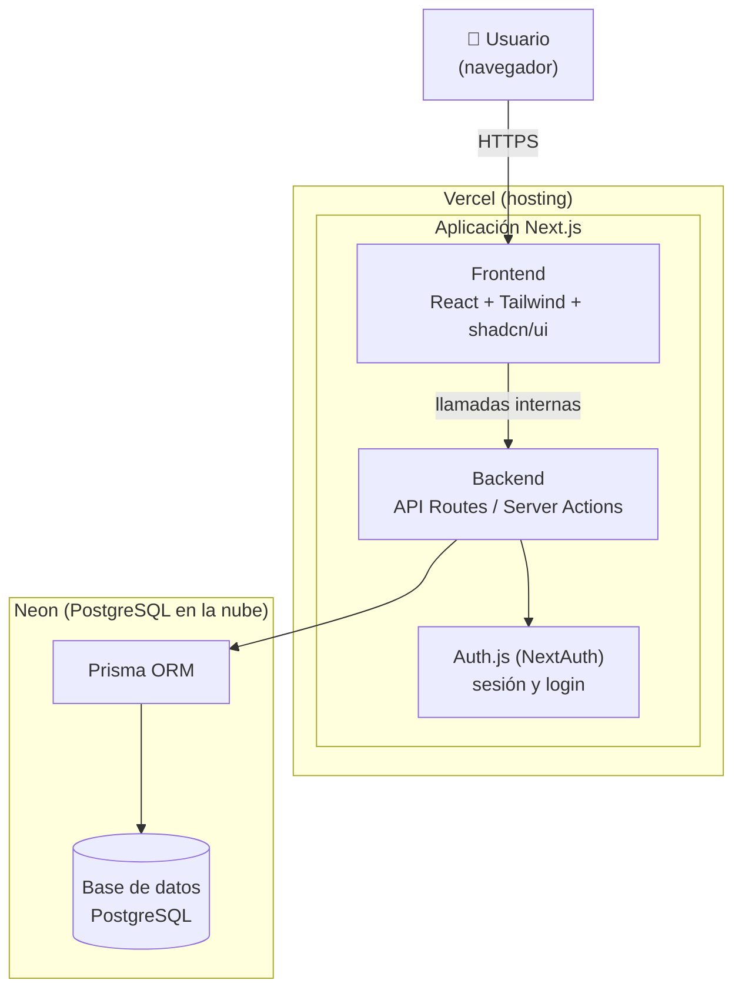
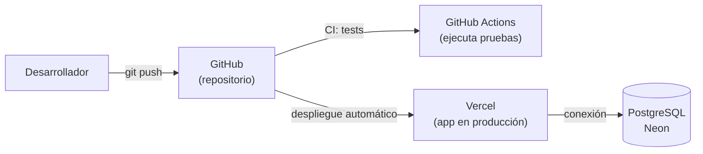
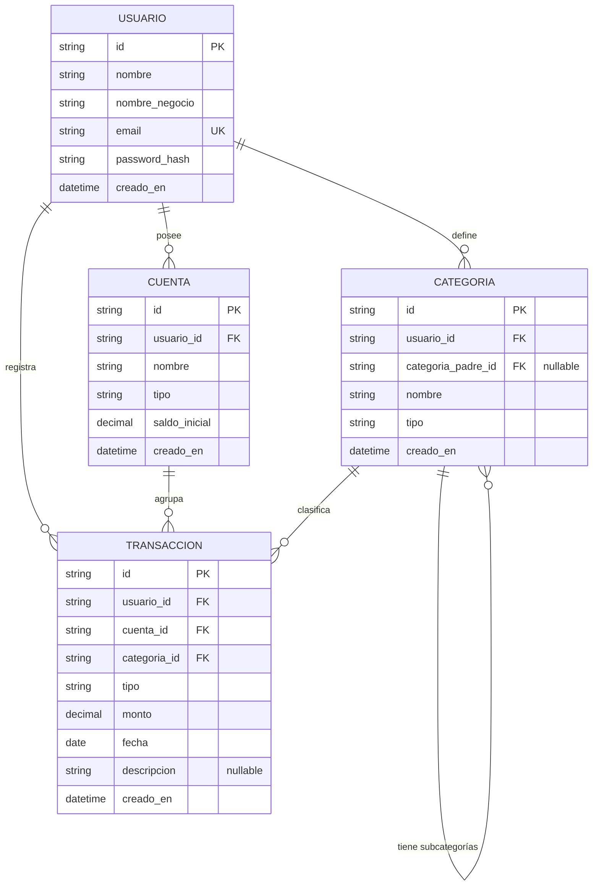

# Cuadre — Control de gastos e ingresos

## Estado del proyecto (Entrega 2, 23 de octubre de 2026)

| Funcionalidad | Estado |
|---|---|
| Registro e inicio de sesión | ✅ Implementado |
| Gestión de cuentas | ✅ Implementado |
| Gestión de categorías | ✅ Implementado |
| Registro de transacciones | ⏳ Pendiente |
| Dashboard | ⏳ Pendiente |
| Despliegue (Vercel + Neon) | ⏳ Pendiente |

**Pendiente tras la Entrega 2:** transacciones, dashboard, despliegue en Vercel + Neon, E2E y
GitHub Actions.

## Índice

0. [Ficha del proyecto](#0-ficha-del-proyecto)
1. [Descripción general del producto](#1-descripción-general-del-producto)
2. [Arquitectura del sistema](#2-arquitectura-del-sistema)
3. [Modelo de datos](#3-modelo-de-datos)
4. [Especificación de la API](#4-especificación-de-la-api)
5. [Historias de usuario](#5-historias-de-usuario)
6. [Tickets de trabajo](#6-tickets-de-trabajo)
7. [Pull requests](#7-pull-requests)
8. [Flujo de trabajo con IA y arnés](#8-flujo-de-trabajo-con-ia-y-arnés)

---

## 0. Ficha del proyecto

### 0.1. Tu nombre completo:
Napoleón Chávez

### 0.2. Nombre del proyecto:
Cuadre

### 0.3. Descripción breve del proyecto:
Cuadre es una aplicación web de control de gastos e ingresos para quien
necesita controlar el dinero que entra y sale de su negocio o actividad.
Reemplaza las hojas de cálculo por una herramienta simple: registrar un
movimiento toma segundos, y un panel muestra de un vistazo el saldo por cuenta,
el flujo del período y en qué se está yendo el dinero. El MVP cubre un flujo
financiero completo, con una arquitectura ordenada que deja espacio para crecer
en el futuro.

### 0.4. URL del proyecto:
Pendiente — despliegue previsto en Vercel + Neon para la entrega final. En la
Entrega 2 la app se ejecuta en local siguiendo 1.4 y se prueba con 1.5.

### 0.5. URL o archivo comprimido del repositorio:
https://github.com/nchavez2016/AI4Devs-finalproject

---

## 1. Descripción general del producto

### 1.1. Objetivo:

Dar a quien necesita controlar sus gastos e ingresos una forma clara y
confiable de saber en qué se va su dinero. Hoy muchas personas y negocios
pequeños llevan sus movimientos en cuadernos o en hojas de Excel que se
descuadran con facilidad, y viven con la incertidumbre de no saber si realmente
ganan o pierden. Cuadre convierte ese desorden en algo entendible: registrar un
movimiento es rápido, y el usuario ve al instante su saldo por cuenta, cuánto
entró y salió en el período, y cuáles son sus mayores gastos.

El valor central es **claridad y control**: menos tiempo peleando con fórmulas y
más certeza para tomar decisiones. El usuario objetivo es cualquier persona que
gestiona el dinero de su negocio o actividad y necesita una herramienta más viva
y confiable que una hoja de cálculo, pero más simple que un sistema contable
completo.

### 1.2. Características y funcionalidades principales:

Cada funcionalidad se marca con una etiqueta de alcance: **[MVP]** si se
implementa en este proyecto, o **[DOCUMENTADO]** si se describe para dar contexto
del producto pero queda fuera del alcance de esta entrega. Dentro del MVP, el
estado real a fecha de la Entrega 2 se marca con ✅ (implementado) o ⏳
(pendiente).

- **[MVP] ✅ Registro y acceso de usuario.** El usuario crea una cuenta e inicia
  sesión; sus datos financieros son privados y solo él los ve. Al registrarse
  puede dar un nombre a su negocio o actividad, que identifica su espacio de
  trabajo.
- **[MVP] ✅ Gestión de cuentas.** El usuario crea y administra sus cuentas de
  dinero (por ejemplo banco, efectivo, billetera digital), para saber cuánto
  tiene disponible en cada una. El saldo mostrado hoy es el saldo inicial; se
  calculará con las transacciones cuando esa funcionalidad exista.
- **[MVP] ⏳ Registro de transacciones.** El usuario registra un ingreso o un
  gasto, asociándolo a una cuenta, una categoría, un monto y una fecha; puede
  además listar, editar y eliminar sus movimientos. Pendiente para la entrega
  final.
- **[MVP] ✅ (parcial) Categorización.** El usuario ya puede crear y consultar
  sus categorías de ingreso y de gasto (de primer nivel; las subcategorías
  quedan fuera de esta entrega). Clasificar una transacción concreta depende de
  que exista el registro de transacciones, todavía pendiente.
- **[MVP] ⏳ Dashboard.** Una pantalla de resumen muestra el saldo actual, el
  total de ingresos y gastos del período y las principales categorías de gasto,
  todo calculado automáticamente a partir de las transacciones. Pendiente para
  la entrega final.

Estas funcionalidades corresponden a las historias de usuario priorizadas que se
detallan en la sección 5.

**Capacidades documentadas para versiones futuras.** Para mantener el MVP acotado
y bien ejecutado, las siguientes capacidades se dejan descritas como visión de
producto, pero no se implementan en esta entrega. La arquitectura se diseña sin
cerrarles la puerta:

- **[DOCUMENTADO]** Metas de ahorro, presupuestos con alertas, préstamos y
  deudas, y tarjetas de crédito.
- **[DOCUMENTADO]** Planes de suscripción y cobro.
- **[DOCUMENTADO]** Un asistente de IA que dé recomendaciones a partir de los
  datos del propio negocio.

### 1.3. Diseño y experiencia de usuario:

El flujo principal del usuario es directo: se registra e inicia sesión, crea al
menos una cuenta de dinero, registra sus primeros ingresos y gastos
clasificándolos por categoría, y a partir de ahí el dashboard le devuelve una
lectura inmediata de su situación —saldo por cuenta, balance del período y sus
mayores gastos.

La experiencia busca sentirse tan ágil como una hoja de cálculo pero sin su
fragilidad: capturar un movimiento debe tomar segundos, y los números del
resumen se actualizan solos sin fórmulas que se rompan.

Capturas del flujo implementado hasta la Entrega 2:

| Pantalla | Captura |
|---|---|
| Inicio de sesión |  |
| Panel |  |
| Creación de cuenta |  |
| Creación de categoría |  |

*(Videotutorial del recorrido: pendiente de confirmar si se agrega.)*

### 1.4. Instrucciones de instalación:

Pasos comprobados contra `package.json` y `docker-compose.yml`, coherentes con la
arquitectura de la sección 2:

1. **Requisitos previos:** Node.js y Docker instalados.
2. **Clonar el repositorio** (rama de la Entrega 2) e instalar dependencias:
   ```
   git clone --branch feature/entrega-2-NCH https://github.com/nchavez2016/AI4Devs-finalproject.git
   cd AI4Devs-finalproject
   npm install
   ```
   El proyecto es una única aplicación Next.js (no hay carpetas de frontend y
   backend por separado).
3. **Levantar la base de datos local** con Docker:
   ```
   docker compose up -d
   ```
   Arranca un contenedor `cuadre-db` con PostgreSQL 16 en el puerto 5432
   (usuario, contraseña y base `cuadre`, definidos en `docker-compose.yml`).
4. **Configurar variables de entorno** copiando `.env.example` a `.env`:
   - `DATABASE_URL`: ya viene lista para la base local de Docker, no hace falta
     tocarla en desarrollo.
   - `AUTH_SECRET`: obligatorio, mínimo 32 caracteres. Se genera con:
     ```
     node -e "console.log(require('node:crypto').randomBytes(32).toString('base64'))"
     ```
5. **Aplicar las migraciones** con Prisma:
   ```
   npx prisma migrate deploy
   npx prisma generate
   ```
   `migrate deploy` aplica las migraciones existentes sin crear nuevas ni hacer
   preguntas; `migrate dev` queda para quien desarrolla cambios de esquema.
   No existe un seed de datos de ejemplo: la base queda vacía y lista para que
   cada usuario se registre (ver 1.5).
6. **Arrancar la aplicación:**
   ```
   npm run dev
   ```
   Queda disponible en `http://localhost:3000`.

En desarrollo se usa PostgreSQL local (vía Docker); en producción (pendiente de
confirmar, prevista en Vercel + Neon) la misma aplicación se conectaría cambiando
únicamente `DATABASE_URL`.

**Ejecutar los tests** (verificado en `package.json` y `vitest.config.mts`):

```
npm run test:run
```

Las pruebas unitarias (`*.test.ts(x)`) corren con variables de entorno
ficticias y no tocan una base de datos real. Las de integración
(`*.int.test.ts`) necesitan una base PostgreSQL de prueba llamada por defecto
`cuadre_test`; se puede apuntar a otra con la variable de entorno
`TEST_DATABASE_URL`.

### 1.5. Cómo probar el MVP:

**No hay usuario de demostración ni datos de ejemplo (seed).** Para revisar la
app, regístrate con un email y contraseña nuevos: el formulario de registro crea
tu usuario y, automáticamente, tus 7 categorías por defecto (5 de gasto y 2 de
ingreso).

**Credenciales de prueba sugeridas** (se registran una sola vez en el paso 1;
después basta con iniciar sesión):

| Campo | Valor |
|---|---|
| Email | `revisor@cuadre.test` |
| Contraseña | `Revisor2026!` |
| Nombre del negocio | `Negocio de prueba` |

Recorrido sugerido, con la app corriendo (`npm run dev`) y la base levantada:

1. Abre `http://localhost:3000` y entra a **Registro**. Crea un usuario con las
   credenciales de prueba de arriba (o las tuyas).
2. Al registrarte entras directo al **panel**, con tu nombre de negocio y los
   enlaces a Cuentas y Categorías.
3. Entra a **Cuentas** y crea una, por ejemplo "Banco Pichincha", tipo banco,
   con saldo inicial 500.00. La lista muestra la cuenta con ese saldo.
4. Intenta crear otra cuenta con el mismo nombre (sin distinguir mayúsculas):
   el formulario rechaza el duplicado con un mensaje junto al campo.
5. Entra a **Categorías** y confirma que ya existen 7 (Arriendo, Insumos, Otros,
   Servicios básicos, Transporte, Otros ingresos, Ventas). Crea una propia, por
   ejemplo "Publicidad" de tipo gasto.
6. Intenta crear otra categoría de gasto con el mismo nombre: se rechaza igual
   que con las cuentas.
7. Cierra sesión desde el botón correspondiente y confirma que vuelves al login.

*(Registrar transacciones y ver el dashboard quedan pendientes; no forman parte
de este recorrido todavía.)*

---

## 2. Arquitectura del sistema

### 2.1. Diagrama de arquitectura:

Cuadre es una aplicación web construida sobre Next.js, que aloja en un solo
proyecto tanto la interfaz de usuario (frontend) como la lógica de servidor
(backend, vía API Routes / Server Actions). Los datos se guardan en una base de
datos PostgreSQL, a la que se accede mediante el ORM Prisma. La autenticación de
usuarios se gestiona con Auth.js (NextAuth). El despliegue es en Vercel, con la
base de datos alojada en Neon (PostgreSQL gestionado en la nube).



**Patrón arquitectónico.** Cuadre sigue una **arquitectura monolítica modular en
capas** dentro de un único proyecto Next.js (lo que se conoce como aplicación
full-stack "fullstack framework"). Se eligió este patrón, y no microservicios ni
un backend separado, por tres razones concretas para este proyecto:

- **Un solo desarrollador, plazo corto.** Mantener frontend y backend en un mismo
  proyecto reduce la cantidad de piezas que configurar, desplegar y depurar.
- **Menos superficie de error.** No hay que coordinar CORS, dos despliegues, ni
  contratos entre servicios separados; el frontend llama a su propio backend.
- **Capa gratuita de punta a punta.** Vercel + PostgreSQL gestionado permiten
  desplegar el MVP sin costo inicial mientras el uso sea bajo.

**Beneficios.** Velocidad de desarrollo, despliegue simple (cada push a la rama
principal se publica solo), y un stack muy documentado que la IA conoce bien.

**Sacrificios / limitaciones asumidas.** Un monolito escala de forma menos
granular que los microservicios: si en el futuro un módulo (por ejemplo, un
agente de IA) necesitara escalar por separado, habría que extraerlo. Para el
alcance del MVP esta limitación no es relevante, y el diseño en capas facilita
esa extracción más adelante.

### 2.2. Descripción de componentes principales:

**Frontend (React + Tailwind CSS).** Es la capa que ve el usuario: las pantallas
de login, registro, panel, cuentas y categorías, construidas hoy con
componentes propios (`src/components/ui/`) y Tailwind para los estilos.
shadcn/ui está aprobado para el MVP pero todavía no se ha instalado; cuando se
necesiten componentes más complejos (tablas, gráficos) se evaluará incorporarlo.
Los gráficos del dashboard (pendiente) se dibujan con una librería de charts
(Recharts, aprobada y aún no instalada).

**Backend (Next.js API Routes / Server Actions).** Es la lógica de servidor:
recibe las peticiones del frontend, valida los datos, aplica las reglas de
negocio (por ejemplo, que una cuenta o categoría pertenezca al usuario
autenticado) y habla con la base de datos a través de Prisma. Aquí también se
calcularán los totales y agregados que alimentarán el dashboard (pendiente).

**Autenticación (Auth.js / next-auth v5 beta, versión exacta `5.0.0-beta.32`).**
Gestiona el registro, el inicio de sesión y la sesión activa del usuario. Cada
petición al backend se asocia a un usuario autenticado, y ese identificador es
el que garantiza que cada persona solo vea sus propios datos.

**Capa de datos (Prisma + PostgreSQL).** Prisma es el traductor entre el código y
la base de datos: define el esquema (las tablas y relaciones) en un solo archivo
y genera las consultas de forma segura y tipada. PostgreSQL es el motor donde
viven realmente los datos (usuarios, cuentas, categorías, transacciones).

**Capa de repositorios (patrón Repository).** Entre la lógica de negocio y Prisma
se interpone una capa de repositorios: piezas cuya única responsabilidad es leer
y escribir datos (por ejemplo, `TransaccionRepository` con operaciones como
"crear", "listar por usuario", "sumar por categoría"). La lógica de negocio nunca
llama a Prisma directamente, sino que pide los datos al repositorio. Esto aporta
dos ventajas concretas: (1) si cambia el origen de datos —o se necesita un
repositorio simulado con datos de prueba para una demostración sin base de datos
real— solo cambia el repositorio, no el resto del sistema; y (2) facilita las
pruebas, porque se puede sustituir el repositorio real por uno de prueba sin
levantar una base de datos. Es el mismo patrón que emplean los proyectos de
referencia del curso con este stack.

### 2.3. Descripción de alto nivel del proyecto y estructura de ficheros:

El proyecto sigue la estructura estándar de una aplicación Next.js (App Router),
organizada por responsabilidad. Estructura actual, verificada con `git
ls-files` (solo directorios y archivos clave; se omiten tests y archivos
generados):

```
cuadre/
├── prisma/
│   ├── migrations/              # Migraciones aplicadas (no se editan a mano)
│   └── schema.prisma            # Definición del modelo de datos
├── src/
│   ├── app/
│   │   ├── (privado)/
│   │   │   ├── panel/           # Panel (dashboard provisional) ✅
│   │   │   ├── cuentas/         # Gestión de cuentas ✅
│   │   │   └── categorias/      # Gestión de categorías ✅
│   │   ├── login/                ✅
│   │   ├── registro/             ✅
│   │   └── api/auth/[...nextauth]/route.ts  ✅
│   ├── components/
│   │   ├── EncabezadoPagina.tsx  ✅
│   │   └── ui/                   # Button, Campo, Importe ✅
│   ├── config/env.ts            # Validación de variables de entorno ✅
│   ├── server/
│   │   ├── auth/                 ✅
│   │   ├── cuentas/               ✅
│   │   ├── categorias/            ✅
│   │   └── repositories/         # Acceso a datos: encapsula Prisma ✅
│   ├── test/                     # Fixtures y BD de prueba (Vitest) ✅
│   └── proxy.ts                  # Antes "middleware.ts" en Next.js 16 ✅
├── docs/diseno/sistema/         # Tokens y sistema de diseño ✅
├── openspec/                     # Specs y changes (OpenSpec) ✅
├── .github/workflows/            ⏳ Pendiente (no existe aún)
├── docker-compose.yml            ✅
├── .env.example                  ✅
└── readme.md
```

Pendiente: `src/app/(privado)/transacciones/` (registro de transacciones) y un
`dashboard/` con cálculos reales; hoy existe `panel/` como pantalla de
bienvenida provisional. La separación clave es: `app/` contiene las pantallas y
los endpoints; `server/` contiene la lógica de negocio y, dentro de
`server/repositories/`, la capa de acceso a datos que encapsula Prisma (patrón
Repository); `prisma/` define el modelo de datos. Esto mantiene la lógica
separada tanto de la presentación como del acceso a datos, de modo que una nueva
pantalla —o el reemplazo del origen de datos por uno simulado para pruebas— no
obliga a tocar el resto del sistema.

### 2.4. Infraestructura y despliegue:



El flujo de despliegue es de integración y despliegue continuos (CI/CD): el
código vive en GitHub; cada cambio subido a la rama principal dispara dos cosas
en paralelo: (1) **GitHub Actions** ejecuta automáticamente la suite de pruebas
(integración continua), y (2) **Vercel** construye y publica la nueva versión de
la aplicación en una URL pública (despliegue continuo). La base de datos
PostgreSQL está alojada en Neon (proveedor gestionado en la nube) al que la
aplicación se conecta mediante una variable de entorno segura. Este esquema
cumple el requisito de la entrega final de tener el proyecto desplegado y
accesible por URL.

**Estado: despliegue y GitHub Actions pendientes.**

### 2.5. Seguridad:

Las prácticas de seguridad del MVP, apropiadas para una aplicación que maneja
datos financieros personales, son:

- **✅ Autenticación de usuarios.** El acceso requiere registro e inicio de
  sesión mediante Auth.js; las contraseñas se almacenan con hash (nunca en texto
  plano). Las rutas privadas exigen sesión iniciada.
- **✅ Aislamiento de datos por usuario.** Toda consulta al backend se filtra
  por el identificador del usuario autenticado (implementado en cuentas y
  categorías), de modo que una persona nunca puede leer ni modificar datos de
  otra. Es el control de seguridad más importante del producto.
- **✅ Validación de entradas con Zod.** Cada dato que llega en el cuerpo de una
  petición (montos, nombres, tipos) se valida contra un esquema Zod en el
  servidor antes de aplicar la lógica de negocio, para rechazar datos corruptos o
  maliciosos.
- **✅ Protección contra inyección SQL.** El acceso a datos usa siempre consultas
  parametrizadas de Prisma; nunca se arma SQL concatenando texto del usuario.
- **✅ Protección contra XSS.** React escapa por defecto el contenido que se
  muestra, evitando la inyección de scripts en la interfaz.
- **✅ Variables sensibles fuera del código.** Credenciales de base de datos y
  claves de sesión se guardan como variables de entorno (`.env`, fuera del
  repositorio), y no se colocan datos sensibles en las URLs.
- **⏳ Conexión cifrada en producción.** Pendiente: depende del despliegue en
  Vercel (HTTPS) y Neon (TLS), todavía no realizado.

### 2.6. Tests:

La estrategia de pruebas contempla tres niveles:

- **✅ Pruebas unitarias.** Verifican piezas aisladas de lógica de negocio y
  componentes (Vitest + Testing Library + jsdom), por ejemplo la validación de
  formularios y las acciones de cuentas y categorías.
- **✅ Pruebas de integración.** Verifican que las acciones del backend
  funcionen de extremo a extremo contra una base de datos PostgreSQL real de
  prueba (`*.int.test.ts`), por ejemplo crear una cuenta y comprobar su
  aislamiento por usuario.
- **⏳ Prueba de extremo a extremo (E2E).** Pendiente: Playwright se configurará
  con el primer change que la necesite (ver AGENTS.md). Verificará el flujo
  principal completo desde el navegador, incluyendo registro de transacciones y
  dashboard una vez existan.

**⏳ GitHub Actions.** Pendiente: hoy las pruebas se ejecutan en local (hook de
pre-commit con `npm run lint`, `typecheck` y `test:run`); la ejecución
automática en cada push mediante GitHub Actions está prevista para la entrega
final (ver 2.4).

---

## 3. Modelo de datos

### 3.1. Diagrama del modelo de datos:



### 3.2. Descripción de entidades principales:

**USUARIO** — La persona dueña de los datos, que representa a su negocio o
actividad. Es la raíz de todo: cada cuenta, categoría y transacción pertenece a
un usuario.
- `id` (PK): identificador único del usuario.
- `nombre`: nombre de la persona. NOT NULL.
- `nombre_negocio`: nombre del negocio o actividad que el usuario gestiona (por
  ejemplo "Tienda Napo"). Da identidad de negocio al espacio de trabajo y se
  muestra en el dashboard. NOT NULL.
- `email` (UK): correo, único en el sistema. NOT NULL, UNIQUE.
- `password_hash`: contraseña almacenada como hash. NOT NULL.
- `creado_en`: fecha de alta. NOT NULL, DEFAULT ahora.
- Relaciones: 1:N con CUENTA, CATEGORIA y TRANSACCION.

> Decisión de modelo: en este MVP cada usuario representa un único negocio, y el
> nombre del negocio es un campo del propio usuario. No existe una entidad
> "Empresa" separada, lo que mantiene el modelo simple. El diseño permite
> introducir esa entidad en el futuro si se necesitara gestionar varios negocios,
> sin rehacer lo existente.

**CUENTA** — Un lugar donde el usuario tiene dinero (banco, efectivo, billetera
digital). Permite ver el saldo disponible por cada una.
- `id` (PK): identificador de la cuenta.
- `usuario_id` (FK → USUARIO): dueño de la cuenta. NOT NULL.
- `nombre`: nombre visible (por ejemplo "Banco Pichincha", "Efectivo"). NOT NULL,
  de tipo `citext` (sin distinguir mayúsculas), sin espacios al inicio ni al final,
  de 1 a 150 caracteres. ÚNICO por usuario: `(usuario_id, nombre)`.
- `tipo`: clasificación de la cuenta (por ejemplo banco, efectivo, digital).
- `saldo_inicial`: saldo con el que arranca la cuenta al crearla. DEFAULT 0. El
  saldo actual se calcula sumando este valor y todas sus transacciones.
- `creado_en`: fecha de creación. NOT NULL, DEFAULT ahora.
- Relaciones: N:1 con USUARIO; 1:N con TRANSACCION.

**CATEGORIA** — La clasificación de una transacción (por ejemplo "Ventas",
"Arriendo", "Servicios básicos"). Admite subcategorías mediante una relación
consigo misma (una categoría puede tener una categoría padre).
- `id` (PK): identificador de la categoría.
- `usuario_id` (FK → USUARIO): dueño de la categoría. NOT NULL.
- `categoria_padre_id` (FK → CATEGORIA): categoría padre, si es una subcategoría.
  NULLABLE (si es nulo, es una categoría de primer nivel).
- `nombre`: nombre de la categoría. NOT NULL, de tipo `citext` (sin distinguir
  mayúsculas), sin espacios al inicio ni al final, de 1 a 150 caracteres. ÚNICO por
  usuario y tipo: `(usuario_id, tipo, nombre)`.
- `tipo`: indica si aplica a ingresos o a gastos.
- `creado_en`: fecha de creación. NOT NULL, DEFAULT ahora.
- Relaciones: N:1 con USUARIO; auto-relación 1:N (subcategorías); 1:N con
  TRANSACCION.

**TRANSACCION** — El registro de un movimiento de dinero: el corazón del sistema.
Cada ingreso o gasto es una fila aquí, y de la suma de estas filas se calculan
todos los reportes y el dashboard.
- `id` (PK): identificador de la transacción.
- `usuario_id` (FK → USUARIO): dueño del movimiento. NOT NULL.
- `cuenta_id` (FK → CUENTA): cuenta afectada. NOT NULL.
- `categoria_id` (FK → CATEGORIA): categoría del movimiento. NOT NULL.
- `tipo`: INGRESO o GASTO. NOT NULL.
- `monto`: valor del movimiento, tipo decimal para precisión monetaria. NOT NULL,
  mayor que 0.
- `fecha`: fecha del movimiento. NOT NULL.
- `descripcion`: nota opcional. NULLABLE.
- `creado_en`: fecha de registro en el sistema. NOT NULL, DEFAULT ahora.
- Relaciones: N:1 con USUARIO, con CUENTA y con CATEGORIA.

**Nota de diseño.** El modelo está normalizado hasta la Tercera Forma Normal
(3FN): no hay grupos repetidos, todas las tablas tienen clave primaria simple (por
lo que no hay dependencias parciales), y no se almacenan datos derivados de otros
campos no clave (por ejemplo, la transacción guarda `cuenta_id`, no el nombre de
la cuenta), evitando redundancia y problemas de integridad. Además, el diseño deja
espacio para crecer sin rediseño: el campo `tipo` en la transacción permite añadir
más adelante valores como TRANSFERENCIA sin romper lo existente.

---

## 4. Especificación de la API

La aplicación expone sus operaciones a través de endpoints internos consumidos
por el propio frontend. Todos requieren que el usuario esté autenticado, y todas
las operaciones se restringen automáticamente a los datos del usuario de la
sesión. A continuación se describen los tres endpoints principales del MVP en
formato OpenAPI (resumido).

### Endpoint 1 — Crear transacción

```yaml
POST /api/transacciones
summary: Registra un nuevo ingreso o gasto del usuario autenticado.
security:
  - sessionAuth: []
requestBody:
  required: true
  content:
    application/json:
      schema:
        type: object
        required: [cuentaId, categoriaId, tipo, monto, fecha]
        properties:
          cuentaId:    { type: string, description: "Cuenta afectada" }
          categoriaId: { type: string, description: "Categoría del movimiento" }
          tipo:        { type: string, enum: [INGRESO, GASTO] }
          monto:       { type: number, minimum: 0.01 }
          fecha:       { type: string, format: date }
          descripcion: { type: string, nullable: true }
responses:
  "201": { description: "Transacción creada" }
  "400": { description: "Datos inválidos" }
  "401": { description: "No autenticado" }
```

Ejemplo de petición:

```json
{
  "cuentaId": "cta_001",
  "categoriaId": "cat_ventas",
  "tipo": "INGRESO",
  "monto": 150.00,
  "fecha": "2026-09-17",
  "descripcion": "Venta de producto"
}
```

Ejemplo de respuesta (201):

```json
{
  "id": "trx_012",
  "cuentaId": "cta_001",
  "categoriaId": "cat_ventas",
  "tipo": "INGRESO",
  "monto": 150.00,
  "fecha": "2026-09-17",
  "descripcion": "Venta de producto",
  "creadoEn": "2026-09-17T14:05:00Z"
}
```

### Endpoint 2 — Listar transacciones

```yaml
GET /api/transacciones
summary: Devuelve las transacciones del usuario, con filtros opcionales.
security:
  - sessionAuth: []
parameters:
  - name: desde
    in: query
    schema: { type: string, format: date }
    description: "Fecha inicial del rango (opcional)"
  - name: hasta
    in: query
    schema: { type: string, format: date }
    description: "Fecha final del rango (opcional)"
  - name: tipo
    in: query
    schema: { type: string, enum: [INGRESO, GASTO] }
    description: "Filtrar por tipo (opcional)"
  - name: cuentaId
    in: query
    schema: { type: string }
    description: "Filtrar por cuenta (opcional)"
responses:
  "200": { description: "Lista de transacciones" }
  "401": { description: "No autenticado" }
```

### Endpoint 3 — Resumen del dashboard

```yaml
GET /api/dashboard
summary: Devuelve los totales calculados para el dashboard del período.
security:
  - sessionAuth: []
parameters:
  - name: periodo
    in: query
    schema: { type: string, enum: [dia, semana, mes], default: mes }
    description: "Período de agregación"
responses:
  "200":
    description: "Resumen calculado"
    content:
      application/json:
        schema:
          type: object
          properties:
            totalIngresos:  { type: number }
            totalGastos:    { type: number }
            balance:        { type: number }
            saldosPorCuenta:
              type: array
              items:
                type: object
                properties:
                  cuentaId: { type: string }
                  nombre:   { type: string }
                  saldo:    { type: number }
            topCategoriasGasto:
              type: array
              items:
                type: object
                properties:
                  categoria: { type: string }
                  total:     { type: number }
  "401": { description: "No autenticado" }
```

Ejemplo de respuesta (200):

```json
{
  "totalIngresos": 1200.00,
  "totalGastos": 780.50,
  "balance": 419.50,
  "saldosPorCuenta": [
    { "cuentaId": "cta_001", "nombre": "Banco", "saldo": 950.00 },
    { "cuentaId": "cta_002", "nombre": "Efectivo", "saldo": 120.00 }
  ],
  "topCategoriasGasto": [
    { "categoria": "Arriendo", "total": 400.00 },
    { "categoria": "Servicios básicos", "total": 180.50 }
  ]
}
```

---

## 5. Historias de usuario

### Épicas (organización del backlog)

Las historias del MVP se agrupan en tres épicas, que son los grandes bloques de
capacidad del producto. Cada épica contiene una o más historias de usuario (HU),
y cada historia se descompondrá luego en tickets técnicos (sección 6).

| Épica | Descripción | Historias que agrupa |
|-------|-------------|----------------------|
| **E1 — Cuentas y acceso** | Registro, inicio de sesión y gestión de las cuentas de dinero del usuario. | HU-002 (Gestionar cuentas) + autenticación (transversal, TK-001) |
| **E2 — Gestión de movimientos** | Registro y clasificación del dinero que entra y sale. | HU-001 (Registrar transacción), HU-004 (Categorizar), HU-005 (Editar/eliminar) |
| **E3 — Visión financiera** | Lectura consolidada de la situación del negocio. | HU-003 (Dashboard) |

**Cómo se lee esta jerarquía:**

```
PRD (este documento)
 └── ÉPICA         (bloque grande de capacidad, ej. "Gestión de movimientos")
      └── HISTORIA (lo que el usuario quiere hacer, ej. "registrar un gasto")
           └── TICKET   (trabajo técnico para lograrlo, ej. "endpoint POST")
                └── TAREA    (paso concreto dentro del ticket)
```

Una **historia** describe QUÉ quiere el usuario (lenguaje de negocio); un
**ticket** describe CÓMO se construye (lenguaje técnico). Una misma historia
suele partirse en varios tickets —típicamente uno de base de datos, uno de
backend y uno de frontend—, como se detalla en la sección 6.

---

### Detalle de historias

Las historias siguen el formato estándar "Como / Quiero / Para" con criterios de
aceptación en formato Given/When/Then (Gherkin), que son directamente traducibles
a pruebas automatizadas. El MVP prioriza cuatro historias imprescindibles
(must-have) y una deseable (should-have). Para la documentación de la Entrega 1
se detallan las tres principales, como pide la plantilla.

> Nota de alcance: el registro e inicio de sesión (autenticación) se trata como
> una capacidad transversal, implementada en el scaffold inicial (ver Ticket
> TK-001), sobre la que se apoyan todas las historias siguientes, ya que cada
> operación se restringe a los datos del usuario autenticado. Durante el registro,
> el usuario indica el **nombre de su negocio o actividad**, que identifica su
> espacio de trabajo y se muestra en el dashboard.

### HU-001 — Registrar una transacción ⏳ Pendiente

**Como** persona que gestiona las finanzas de mi negocio
**quiero** registrar un ingreso o un gasto con su monto, fecha, cuenta y categoría
**para** mantener un control ordenado de todo el dinero que entra y sale.

**Prioridad:** Must-have
**Criterios de aceptación:**

```gherkin
Scenario: Registrar un gasto válido
  Given estoy autenticado y tengo al menos una cuenta y una categoría creadas
  When registro una transacción de tipo GASTO con monto 25.50, una fecha,
       una cuenta y una categoría válidas
  Then la transacción queda guardada y asociada a mi usuario
  And aparece en mi listado de transacciones
  And el saldo de la cuenta seleccionada disminuye en 25.50

Scenario: Rechazar una transacción con monto inválido
  Given estoy autenticado
  When intento registrar una transacción con monto 0 o negativo
  Then el sistema rechaza el registro
  And muestra un mensaje indicando que el monto debe ser mayor que cero

Scenario: Rechazar una transacción sin campos obligatorios
  Given estoy autenticado
  When intento registrar una transacción sin cuenta, sin categoría o sin fecha
  Then el sistema rechaza el registro
  And señala cuáles campos son obligatorios
```

---

### HU-002 — Gestionar mis cuentas ✅ Implementado (crear y listar)

**Como** persona que gestiona las finanzas de mi negocio
**quiero** crear y administrar mis cuentas de dinero (banco, efectivo, billetera
digital)
**para** saber cuánto tengo disponible en cada una y a dónde asignar cada
movimiento.

> Implementado hasta la Entrega 2: crear y listar cuentas, con nombre único por
> usuario y aislamiento entre usuarios. El saldo mostrado es el saldo inicial;
> el escenario "Ver el saldo actualizado de una cuenta" de abajo depende de las
> transacciones, todavía pendientes.

**Prioridad:** Must-have
**Criterios de aceptación:**

```gherkin
Scenario: Crear una cuenta nueva
  Given estoy autenticado
  When creo una cuenta con nombre "Banco Pichincha", tipo "banco" y
       saldo inicial 500.00
  Then la cuenta aparece en mi lista de cuentas
  And su saldo actual es 500.00

Scenario: Ver el saldo actualizado de una cuenta
  Given tengo una cuenta con saldo inicial 500.00
  When registro un ingreso de 200.00 y un gasto de 50.00 en esa cuenta
  Then el saldo actual de la cuenta es 650.00

Scenario: Evitar el acceso a cuentas de otro usuario
  Given estoy autenticado como usuario A
  When intento consultar o modificar una cuenta que pertenece al usuario B
  Then el sistema no me permite verla ni modificarla
```

---

### HU-003 — Ver el dashboard financiero ⏳ Pendiente

**Como** persona que gestiona las finanzas de mi negocio
**quiero** ver un panel de resumen con mi saldo, mis ingresos y gastos del
período y mis principales categorías de gasto
**para** entender de un vistazo la situación de mi negocio sin revisar cada
movimiento.

**Prioridad:** Must-have
**Criterios de aceptación:**

```gherkin
Scenario: Ver totales del período
  Given tengo transacciones registradas en el mes actual
  When abro el dashboard con el período "mes"
  Then veo el total de ingresos, el total de gastos y el balance (ingresos
       menos gastos) del mes

Scenario: Ver saldo por cuenta
  Given tengo varias cuentas con movimientos
  When abro el dashboard
  Then veo el saldo actual de cada una de mis cuentas

Scenario: Ver principales categorías de gasto
  Given tengo gastos registrados en distintas categorías
  When abro el dashboard
  Then veo mis categorías de gasto ordenadas de mayor a menor monto

Scenario: Dashboard sin datos
  Given soy un usuario nuevo sin transacciones
  When abro el dashboard
  Then veo los totales en cero y un mensaje que me invita a registrar mi
       primera transacción
```

---

### Historias adicionales del MVP (resumen)

- **HU-004 (Must-have) — Categorizar transacciones. ✅ Implementado (parcial)**
  Como usuario quiero crear categorías y subcategorías y asignarlas a mis
  transacciones, para analizar en qué gano y en qué gasto. (Habilita el
  desglose por categoría del dashboard.) Implementado hasta la Entrega 2: crear
  y listar categorías de primer nivel, únicas por usuario y tipo. Las
  subcategorías y la asignación a una transacción real quedan pendientes.
- **HU-005 (Should-have) — Editar y eliminar transacciones. ⏳ Pendiente** Como
  usuario quiero corregir o borrar un movimiento mal registrado, para mantener
  mis datos fiables. Se implementa solo si el núcleo del MVP está estable.

---

## 6. Tickets de trabajo

Los tickets descomponen las historias en unidades técnicas de trabajo. Se
presentan los tres principales exigidos por la plantilla, cubriendo las tres
capas del sistema: uno de configuración/base de datos, uno de backend y uno de
frontend. Cada ticket incluye su Definition of Done (DoD).

---

### TK-001 — Scaffold del proyecto, base de datos y autenticación ✅ Completo

**Tipo:** Configuración / Base de datos / Backend
**Prioridad:** Alta (bloquea todo lo demás)
**Historia relacionada:** capacidad transversal (habilita HU-001 a HU-005)

**Descripción:**
Inicializar el proyecto Next.js con TypeScript y Tailwind, configurar Prisma
contra PostgreSQL, traducir el modelo de datos (sección 3) a `schema.prisma`,
ejecutar la primera migración, y dejar funcionando el registro e inicio de sesión
de usuarios con Auth.js (next-auth v5 beta).

**Tareas técnicas:**
- Inicializar proyecto Next.js (App Router) + TypeScript + Tailwind.
- Configurar Prisma y la conexión a PostgreSQL mediante variable de entorno
  `DATABASE_URL`.
- Definir en `schema.prisma` las entidades Usuario, Cuenta, Categoria y
  Transaccion con sus relaciones (según sección 3).
- Ejecutar la migración inicial y verificar que las tablas existen.
- Integrar Auth.js con registro, login y hash de contraseñas.
- `proxy.ts` (equivalente a middleware en Next.js 16) que exija sesión iniciada
  en las rutas privadas.

**Definition of Done:**
- [x] El proyecto arranca en local con un solo comando documentado en el readme.
- [x] La migración de Prisma crea todas las tablas del modelo sin errores.
- [x] Un usuario puede registrarse, cerrar sesión y volver a iniciar sesión.
- [x] Las contraseñas se almacenan con hash (nunca en texto plano).
- [x] Una ruta privada redirige al login si no hay sesión activa.
- [x] Variables sensibles fuera del código, con un `.env.example` documentado.

---

### TK-002 — API de transacciones (crear y listar) ⏳ Pendiente

**Tipo:** Backend
**Prioridad:** Alta
**Historia relacionada:** HU-001

**Descripción:**
Implementar los endpoints de creación y listado de transacciones descritos en la
sección 4, con validación de datos en el servidor y aislamiento por usuario.

**Tareas técnicas:**
- Endpoint `POST /api/transacciones` que valide los datos de entrada con Zod
  (monto > 0, tipo INGRESO/GASTO, cuenta y categoría existentes y pertenecientes
  al usuario, fecha válida).
- Endpoint `GET /api/transacciones` con filtros opcionales por rango de fechas,
  tipo y cuenta.
- Capa de servicio que asocie toda operación al usuario autenticado.
- Acceso a datos a través de un repositorio (`TransaccionRepository`) que
  encapsula Prisma, en lugar de llamar a Prisma directamente desde el endpoint
  (patrón Repository).
- Manejo de errores con códigos HTTP correctos (201, 400, 401).

**Definition of Done:**
- [ ] Se puede crear una transacción válida y recuperarla en el listado.
- [ ] Una transacción con monto ≤ 0 o con campos faltantes devuelve 400 con
      mensaje claro.
- [ ] Una petición sin sesión devuelve 401.
- [ ] Un usuario nunca recibe transacciones de otro usuario.
- [ ] Pruebas de integración que cubran los escenarios de HU-001 (caso válido,
      monto inválido, campos faltantes).
- [ ] PR enlazado a la historia HU-001, revisado por una persona.

---

### TK-003 — Pantalla de dashboard ⏳ Pendiente

**Tipo:** Frontend
**Prioridad:** Alta
**Historia relacionada:** HU-003

**Descripción:**
Construir la pantalla de dashboard que consume el endpoint `GET /api/dashboard`
y muestra los totales del período, el saldo por cuenta y las principales
categorías de gasto, con un estado vacío para usuarios nuevos.

**Tareas técnicas:**
- Maquetar la pantalla con componentes de shadcn/ui (tarjetas de resumen, tabla
  de saldos, gráfico de categorías con Recharts).
- Consumir el endpoint de dashboard y mostrar los datos calculados.
- Selector de período (día / semana / mes).
- Estado vacío con mensaje que invita a registrar la primera transacción.
- Diseño responsivo (móvil y escritorio).

**Definition of Done:**
- [ ] El dashboard muestra ingresos, gastos y balance correctos para el período
      seleccionado.
- [ ] Muestra el saldo actual de cada cuenta.
- [ ] Muestra las categorías de gasto ordenadas de mayor a menor.
- [ ] Un usuario sin datos ve el estado vacío con el mensaje de invitación.
- [ ] La pantalla se ve y funciona correctamente en móvil y escritorio.
- [ ] Prueba E2E del flujo: login registrar transacción ver dashboard
      actualizado.
- [ ] PR enlazado a la historia HU-003, revisado por una persona.

---

## 7. Pull requests

> Esta sección se completa durante las Entregas 2 y final, documentando los
> Pull Requests principales del desarrollo.

- **PR Entrega 2:** rama `feature/entrega-2-NCH` — scaffold, autenticación,
  cuentas y categorías. _(Enlace al PR: pendiente de abrir tras el push.)_
- **PR 2:** _(pendiente — Entrega final)_
- **PR 3:** _(pendiente — Entrega final)_

---

## 8. Flujo de trabajo con IA y arnés

Este proyecto se desarrolla con asistencia de agentes de IA (Claude Code y
Antigravity) bajo un arnés de reglas y hooks que exige trazabilidad y TDD. El
detalle completo vive en [AGENTS.md](AGENTS.md); aquí solo un resumen.

**Fuente única de reglas.** `AGENTS.md` es el documento de reglas para
cualquier agente; `CLAUDE.md` solo lo referencia (`@AGENTS.md`) para que Claude
Code lo cargue, sin duplicar contenido.

**Flujo OpenSpec: proponer → aplicar → verificar → archivar.** Ningún código de
producción se escribe sin un *change* aprobado en `openspec/changes/` (reglas
en `openspec/config.yaml`). Cada escenario Given/When/Then de una spec exige un
test con su nombre exacto, y se implementa en TDD estricto: RED (test que
falla por el motivo esperado) → GREEN (mínimo código) → REFACTOR, una subtarea
a la vez, un commit por subtarea.

**Hooks que bloquean, y qué impiden:**
- `.husky/pre-commit` y `pre-merge-commit`: no permiten commits en `main`, y
  corren `npm run lint`, `npx tsc --noEmit` y `npm run test:run` antes de cada
  commit (la suite debe estar en verde).
- `scripts/agents/guard-core.mjs` (vía `.claude/settings.json` en Claude Code y
  `.agents/hooks.json` en Antigravity): bloquea que un agente lea, edite o
  ejecute comandos sobre `.env*`, `.claude/`, `.git/`, `scripts/agents/`,
  `.agents/hooks.json` o migraciones ya aplicadas en `prisma/migrations/`;
  también bloquea `git push/reset/clean/checkout/switch/merge/rebase`,
  `--no-verify` y `npm audit fix`.

**Modelos por fase, prompts clave y ajustes humanos:** ver
[prompts.md](prompts.md#2-modelos-utilizados-por-fase).

**Límites conocidos** (ver `docs/pendientes.md` para el detalle y más):
- Antigravity en Windows pide confirmación para comandos con argumentos aunque
  su prefijo esté en la lista de permitidos; para ciclos largos de `apply` se
  prefiere Claude Code.
- Los workflows de Antigravity (`.agents/workflows/`) se retiran el
  1-nov-2026; tras esa fecha habrá que revisar la migración a las skills
  `openspec-*`.
- El traspaso entre herramientas exige hacer commit antes de cambiar de
  agente, y leer `progress.md` y `tasks.md` al retomar.
